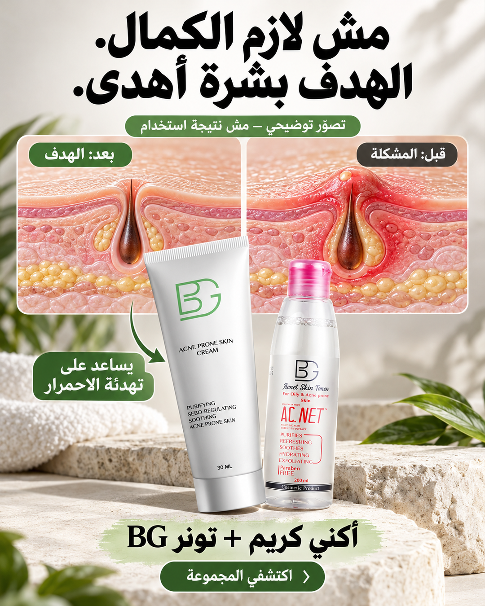
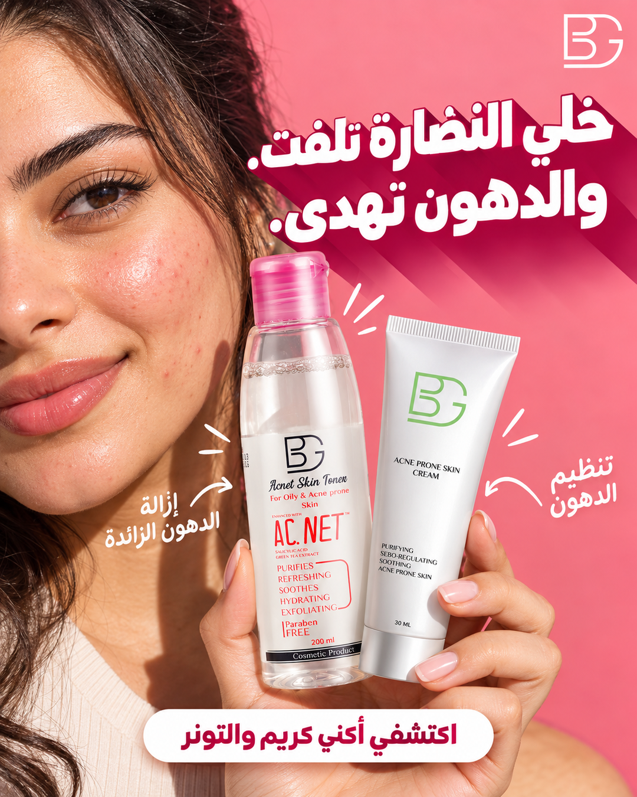
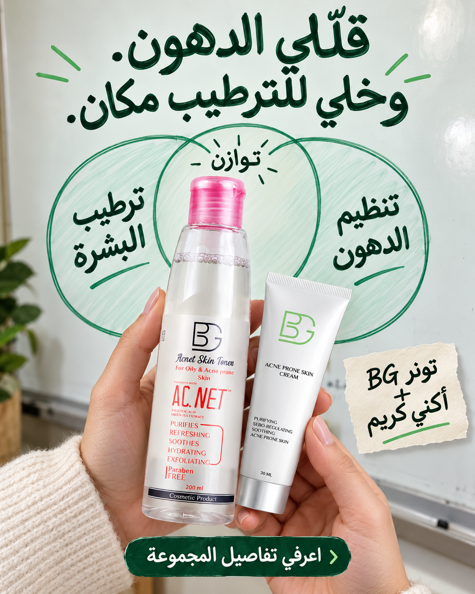
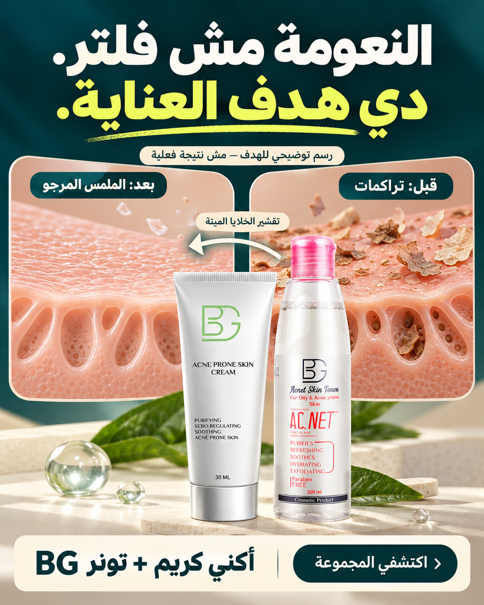
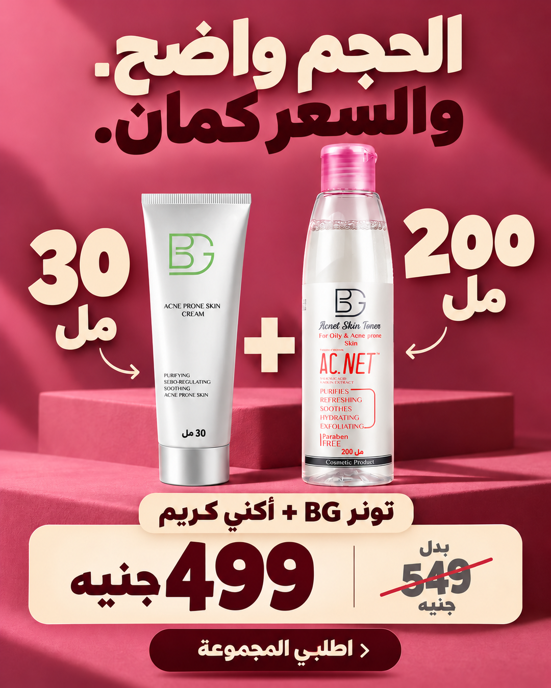
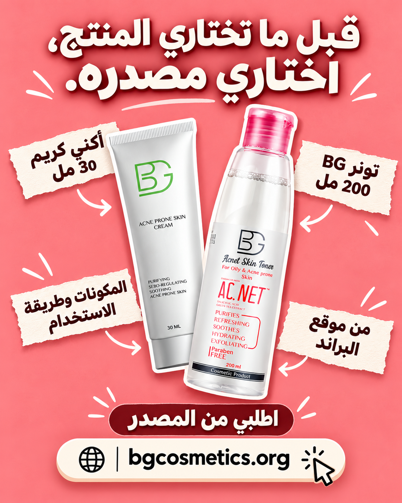
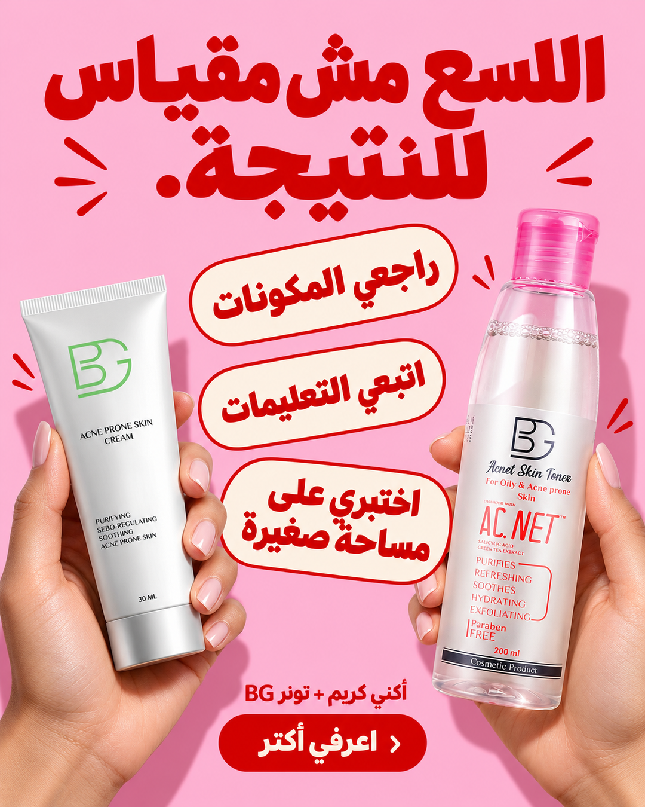
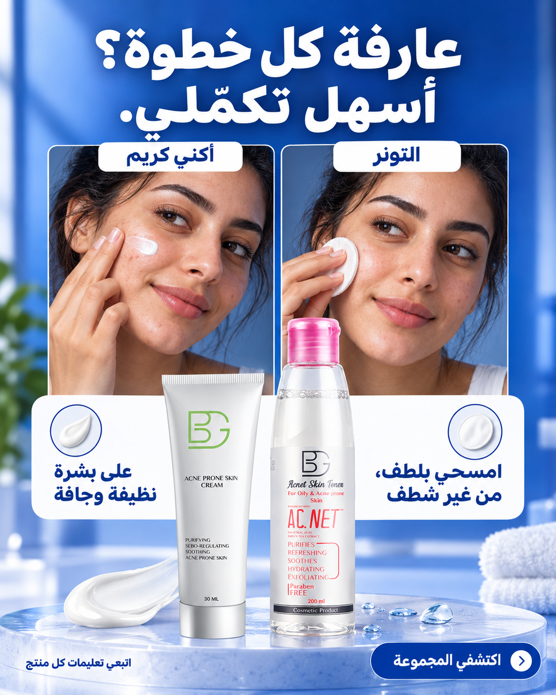
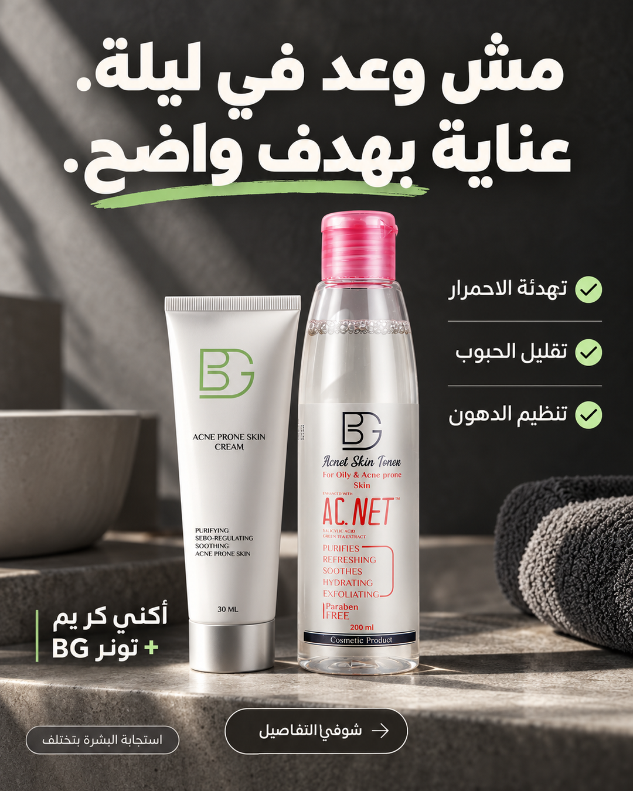
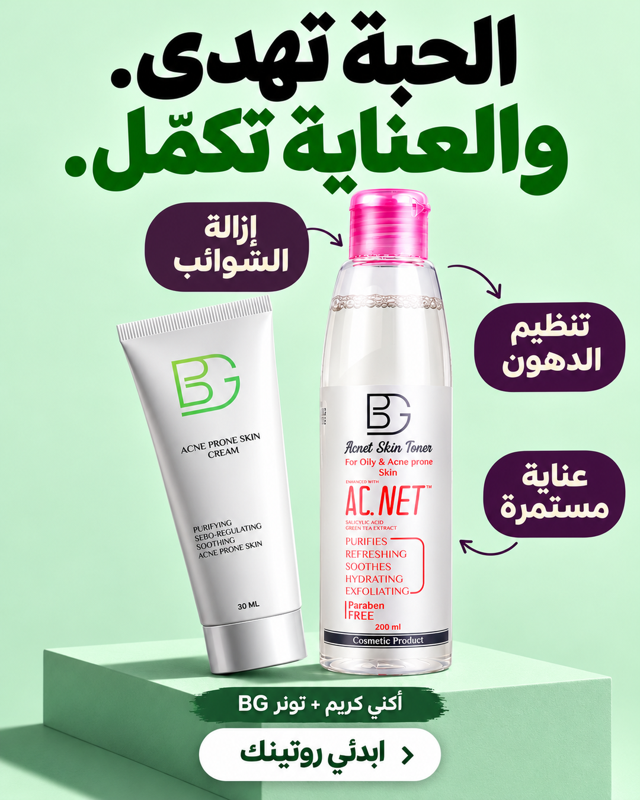

# الدفعة الثالثة — ١٠ فيجوالز من Message Mining

١٠ تصميمات جديدة، منفصلة، بمقاس **١٠٨٠ × ١٣٥٠**، باسم **أكني كريم**. مبنية على قراءة ٥٧ رسالة في الملف المرفوع، مع كوبي مختلف وزاوية محددة لكل تصميم.

[تحميل الدفعة كاملة ZIP](https://github.com/moksehly11-netizen/test/raw/refs/heads/main/bg-meta-ads/batch-3/bg-message-mining-batch-3-10-creatives.zip) · [النصوص CSV](ad-copy-ar.csv?raw=true) · [التحليل الاستراتيجي الكامل](STRATEGY.md)

**عن قبل وبعد:** المقارنتان في ١ و٤ رسومات توضيحية للمشكلة والهدف، وليستا نتائج استخدام حقيقية. صور الأشخاص الأخرى توضيحية. لم تُستخدم مراجعات منتجات أخرى كشهادات على BG.

| رقم | الزاوية | الهوك |
|---|---|---|
| 1 | [تهدئة الحبوب بدل انتظار بشرة مثالية](01-calm-not-perfect.png) | مش لازم الكمال. الهدف بشرة أهدى. |
| 2 | [نضارة طبيعية بدل اللمعان الدهني](02-glow-not-grease.png) | خلي النضارة تلفت. والدهون تهدى. |
| 3 | [توازن الدهون والترطيب](03-balance-with-hydration.png) | قلّلي الدهون. وخلي للترطيب مكان. |
| 4 | [تحسين ملمس البشرة](04-smoother-texture.png) | النعومة مش فلتر. دي هدف العناية. |
| 5 | [وضوح الحجم مقابل السعر](05-know-your-value.png) | الحجم واضح. والسعر كمان. |
| 6 | [الثقة في مصدر الشراء](06-buy-from-brand.png) | قبل ما تختاري المنتج، اختاري مصدره. |
| 7 | [تصحيح الاعتقاد بأن اللسع دليل الفعالية](07-stinging-is-not-proof.png) | اللسع مش مقياس للنتيجة. |
| 8 | [سهولة فهم الاستخدام](08-routine-that-makes-sense.png) | عارفة كل خطوة؟ أسهل تكمّلي. |
| 9 | [توقعات واقعية بدل الوعود السريعة](09-honest-expectations.png) | مش وعد في ليلة. عناية بهدف واضح. |
| 10 | [استمرار العناية بعد هدوء الحبوب](10-care-beyond-a-breakout.png) | الحبة تهدى. والعناية تكمّل. |

## 1. تهدئة الحبوب بدل انتظار بشرة مثالية

**الهوك:** مش لازم الكمال. / الهدف بشرة أهدى.

**النص الأساسي:** أوقات أهم حاجة في العناية هي إن مظهر الحبوب يهدى. أكني كريم من BG يساعد على تقليل الاحمرار والالتهاب والحبوب. اكتشفيه مع التونر في المجموعة. المقارنة في التصميم توضيحية للهدف، وليست نتيجة استخدام فعلية.

**العنوان:** أكني كريم للعناية بالبشرة المعرّضة للحبوب

**النتيجة المرغوبة:** بشرة أهدى وإحساس بالراحة

**هدف الإعلان:** تعريف بفائدة التهدئة

**الشريحة:** ٢٣–٣٥ سنة، تبحث عن تهدئة مظهر الحبوب الملتهبة

**مستوى الوعي:** تبحث عن حل

**مرجع التعدين:** `Amazon Acne Cream!A2`

[تحميل الصورة](01-calm-not-perfect.png?raw=true)

## 2. نضارة طبيعية بدل اللمعان الدهني

**الهوك:** خلي النضارة تلفت. / والدهون تهدى.

**النص الأساسي:** النضارة اللي بندوّر عليها غير اللمعان الدهني. أكني كريم يساعد على تنظيم إفراز الدهون، والتونر يساعد على التخلص من الدهون الزائدة. اتعرّفي على مجموعة BG للبشرة الدهنية والمعرّضة للحبوب.

**العنوان:** أكني كريم يساعد على تنظيم الدهون

**النتيجة المرغوبة:** مظهر طبيعي مرتاح بلمعان دهني أقل

**هدف الإعلان:** إبراز تنظيم الدهون

**الشريحة:** ٢٠–٣٠ سنة، تهتم بالمظهر الطبيعي خلال يومها

**مستوى الوعي:** واعية بالمشكلة

**مرجع التعدين:** `Amazon Acne Cream!A16,A22; Amazon Toners!A7`

[تحميل الصورة](02-glow-not-grease.png?raw=true)

## 3. توازن الدهون والترطيب

**الهوك:** قلّلي الدهون. / وخلي للترطيب مكان.

**النص الأساسي:** لما تدوري على عناية للبشرة الدهنية، خلي الترطيب جزء من اختيارك. تونر BG يساعد على إزالة الدهون الزائدة، ومذكور على عبوته الترطيب كواحدة من فوائده. اكتشفيه مع أكني كريم في المجموعة.

**العنوان:** تونر BG: عناية بالدهون وترطيب

**النتيجة المرغوبة:** التحكم في الدهون مع الحفاظ على الترطيب

**هدف الإعلان:** معالجة الخوف من الجفاف

**الشريحة:** ٢٤–٣٨ سنة، تخشى جفاف البشرة مع منتجات العناية بالحبوب

**مستوى الوعي:** تقارن حلولًا

**مرجع التعدين:** `Amazon Acne Cream!A7,A17; Amazon Toners!A6,A8,A24`

[تحميل الصورة](03-balance-with-hydration.png?raw=true)

## 4. تحسين ملمس البشرة

**الهوك:** النعومة مش فلتر. / دي هدف العناية.

**النص الأساسي:** ملمس أنعم يبدأ بفهم دور كل خطوة. أكني كريم يساعد على إزالة الخلايا الميتة وتحسين مظهر المسام. اكتشفي دوره مع تونر BG. الرسم يوضّح الهدف من العناية، وليس صورة نتيجة فعلية أو وعدًا بمدة محددة.

**العنوان:** أكني كريم للعناية بملمس البشرة

**النتيجة المرغوبة:** ملمس أنعم ومظهر مسام أقل وضوحًا

**هدف الإعلان:** شرح دور التقشير

**الشريحة:** ٢٥–٤٠ سنة، تهتم بملمس البشرة وتراكم الخلايا الميتة

**مستوى الوعي:** تبحث عن حل

**مرجع التعدين:** `Amazon Toners!A22,A26`

[تحميل الصورة](04-smoother-texture.png?raw=true)

## 5. وضوح الحجم مقابل السعر

**الهوك:** الحجم واضح. / والسعر كمان.

**النص الأساسي:** قبل ما تقارني السعر، شوفي إيه جوّه المجموعة: تونر BG سعة ٢٠٠ مل + أكني كريم ٣٠ مل، بـ٤٩٩ بدل ٥٤٩ جنيه. حجم كل منتج واضح، وتوفير ٥٠ جنيه على المجموعة.

**العنوان:** أكني كريم والتونر بـ٤٩٩ جنيه

**النتيجة المرغوبة:** شراء مفهوم بقيمة واضحة من غير تخمين

**هدف الإعلان:** شراء المجموعة

**الشريحة:** ٢٢–٤٠ سنة، تقارن حجم العبوة وتكلفة الشراء

**مستوى الوعي:** قريبة من الشراء

**مرجع التعدين:** `Amazon Toners!A3,A27; Amazon Acne Cream!A27`

[تحميل الصورة](05-know-your-value.png?raw=true)

## 6. الثقة في مصدر الشراء

**الهوك:** قبل ما تختاري المنتج، / اختاري مصدره.

**النص الأساسي:** الثقة في الشراء تبدأ من مصدر واضح. اتعرّفي على أكني كريم وتونر BG، بمكوناتهم وأحجامهم وطريقة استخدامهم، واطلبي المجموعة مباشرة من bgcosmetics.org. المجموعة بـ٤٩٩ بدل ٥٤٩ جنيه.

**العنوان:** اطلبي مجموعة BG من موقع البراند

**النتيجة المرغوبة:** الاطمئنان إلى مصدر الطلب ومعرفة ما ستستلمه

**هدف الإعلان:** الشراء من موقع البراند

**الشريحة:** ٢٥–٤٠ سنة، تقلق من التقليد واختلاف العبوات

**مستوى الوعي:** تعرف الحل وتختار البائع

**مرجع التعدين:** `Amazon Acne Cream!A23,A24; Amazon Toners!A4,A5,A11`

[تحميل الصورة](06-buy-from-brand.png?raw=true)

## 7. تصحيح الاعتقاد بأن اللسع دليل الفعالية

**الهوك:** اللسع مش مقياس / للنتيجة.

**النص الأساسي:** العناية مش اختبار تحمّل. إحساس اللسع لوحده مش دليل إن المنتج بيشتغل. راجعي المكونات وتعليمات الاستخدام، واختبري المنتج على مساحة صغيرة. اتعرّفي على أكني كريم وتونر BG ومناسبتهم لروتينك؛ ومع التهيّج، وقّفي الاستخدام واستشيري مختص.

**العنوان:** اختاري عنايتك على أساس واضح

**النتيجة المرغوبة:** العناية براحة وثقة دون اعتبار الألم ضرورة

**هدف الإعلان:** توعية باختيار واستخدام واعيين

**الشريحة:** ٢٠–٣٥ سنة، جرّبت منتجًا مزعجًا وتخشى التهيّج

**مستوى الوعي:** واعية بالمشكلة ومترددة

**مرجع التعدين:** `Amazon Acne Cream!A4,A6,A9; Amazon Toners!A10,A21,A28`

[تحميل الصورة](07-stinging-is-not-proof.png?raw=true)

## 8. سهولة فهم الاستخدام

**الهوك:** عارفة كل خطوة؟ / أسهل تكمّلي.

**النص الأساسي:** التونر: امسحي البشرة بلطف بقطنة مبللة بالمنتج، من غير شطف. أكني كريم: يُستخدم على بشرة نظيفة وجافة مع تدليك لطيف، مرتين يوميًا حسب تعليمات المنتج. راجعي التعليمات قبل الاستخدام وخلي كل خطوة واضحة.

**العنوان:** اعرفي طريقة استخدام أكني كريم والتونر

**النتيجة المرغوبة:** روتين واضح يسهل اتباعه

**هدف الإعلان:** تعليم طريقة الاستخدام

**الشريحة:** ٢٠–٣٢ سنة، تبدأ روتينًا وتحتاج خطوات واضحة

**مستوى الوعي:** تعرف المنتج وتحتاج توضيحًا

**مرجع التعدين:** `Amazon Acne Cream!A8; Amazon Toners!A15`

[تحميل الصورة](08-routine-that-makes-sense.png?raw=true)

## 9. توقعات واقعية بدل الوعود السريعة

**الهوك:** مش وعد في ليلة. / عناية بهدف واضح.

**النص الأساسي:** لما تكوني جرّبتي كتير، الوعد الكبير مش كفاية. شوفي الهدف من المجموعة: أكني كريم يساعد على تقليل الحبوب وتهدئة الاحمرار، والتونر يساعد على تنظيم الدهون. تعرّفي على التفاصيل، مع توقعات واقعية لأن استجابة البشرة بتختلف.

**العنوان:** اعرفي هدف العناية قبل ما تختاري

**النتيجة المرغوبة:** فهم الهدف والحكم على العناية بواقعية

**هدف الإعلان:** بناء الثقة في قرار الاختيار

**الشريحة:** ٢٧–٤٠ سنة، محبطة من وعود المنتجات وعدم رؤية فرق

**مستوى الوعي:** تقارن ومتحفظة

**مرجع التعدين:** `Amazon Acne Cream!A5,A14,A28; Amazon Toners!A2,A30`

[تحميل الصورة](09-honest-expectations.png?raw=true)

## 10. استمرار العناية بعد هدوء الحبوب

**الهوك:** الحبة تهدى. / والعناية تكمّل.

**النص الأساسي:** العناية بالبشرة المعرّضة للحبوب ليها دور بعد ما الحبة تهدى. تونر BG يساعد على إزالة الشوائب المتبقية وتنظيم الدهون، ويساعد على الحد من ظهور حبوب جديدة. اكتشفيه مع أكني كريم في المجموعة.

**العنوان:** عناية مستمرة للبشرة المعرّضة للحبوب

**النتيجة المرغوبة:** استمرار العناية ببشرة أهدى وتقليل فرص الحبوب الجديدة

**هدف الإعلان:** إبراز دور التونر في الوقاية من ظهور حبوب جديدة

**الشريحة:** ٢٤–٣٨ سنة، تهتم بتكرار ظهور الحبوب واستمرار العناية

**مستوى الوعي:** تبحث عن روتين مستمر

**مرجع التعدين:** `Amazon Toners!A22,A25,A31; Amazon Acne Cream!A11,A25`

[تحميل الصورة](10-care-beyond-a-breakout.png?raw=true)

## بيانات المنتج والتسليم

المجموعة: أكني كريم ٣٠ مل + تونر BG سعة ٢٠٠ مل. السعر المعتمد: ٤٩٩ بدل ٥٤٩ جنيه. راجع استمرار العرض عند إطلاق الحملة. صور العبوات الأصلية من صاحب البراند، وتم استخدامها كمراجع بصرية للتوليد. فوائد الاستخدام مستندة إلى [صفحة المجموعة](https://bgcosmetics.org/products/full-oily-skin-kit-copy) والعبوات. لا توجد نسب نجاح أو مدد نتائج مختلقة.

كل إعلان يختبر فرضية إبداعية؛ لم تُطلق حملة أو تُقَس نتائج شراء لهذه الدفعة. لم يُنشأ تنفيذ يومي تلقائي.
