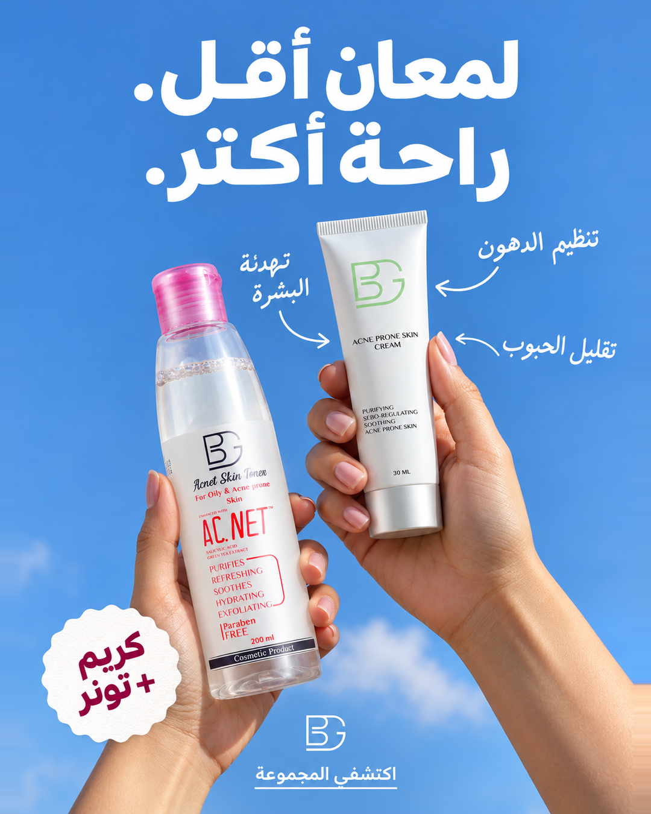
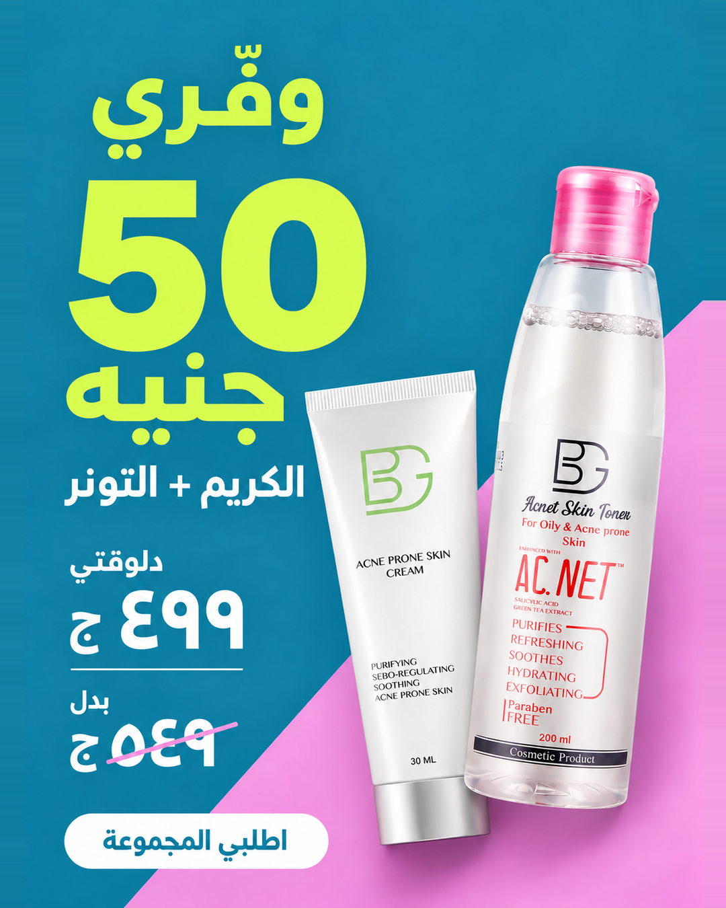
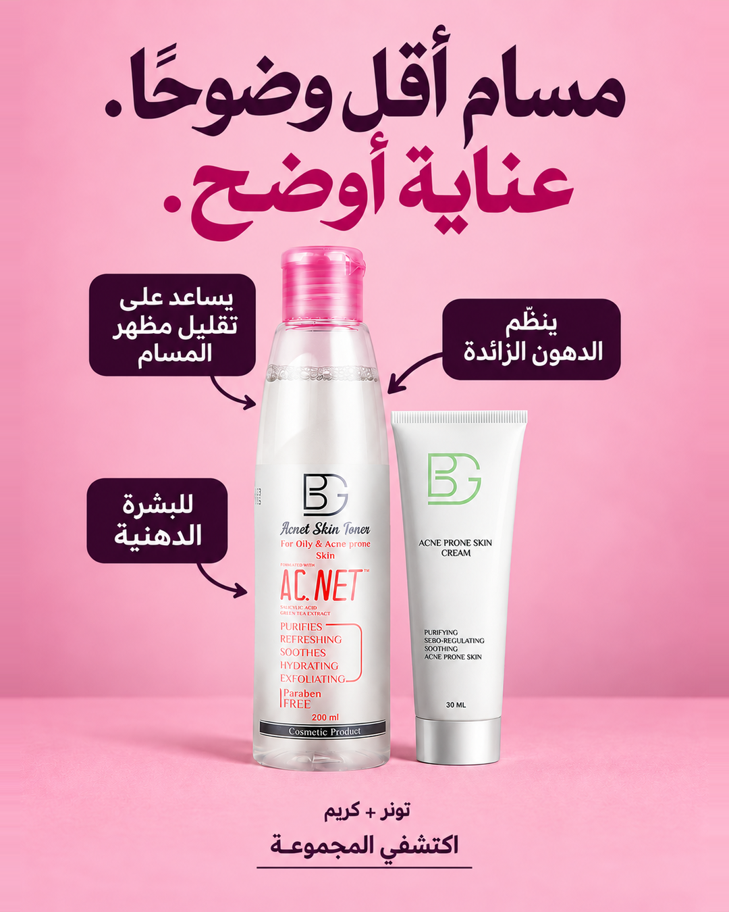
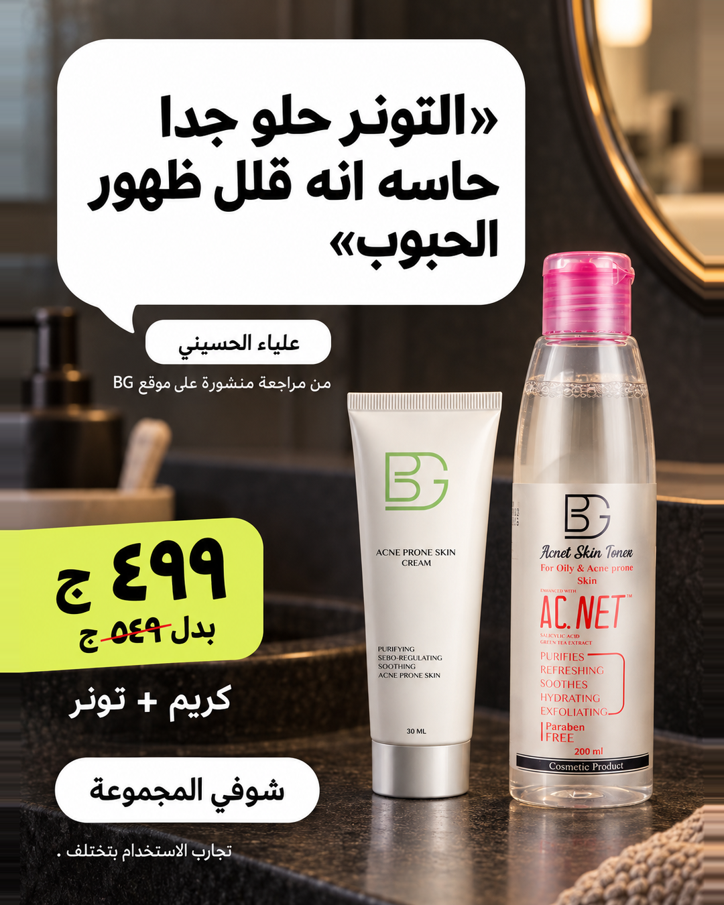
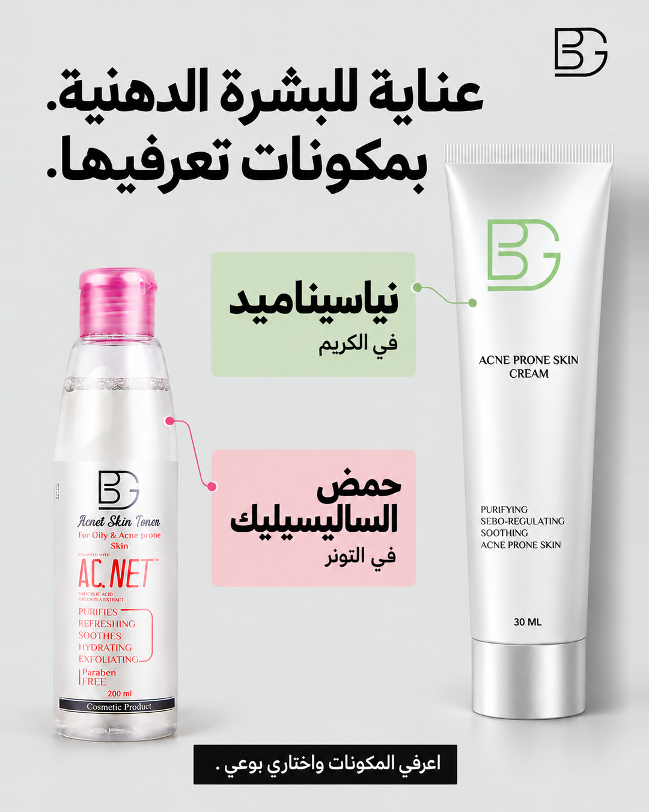
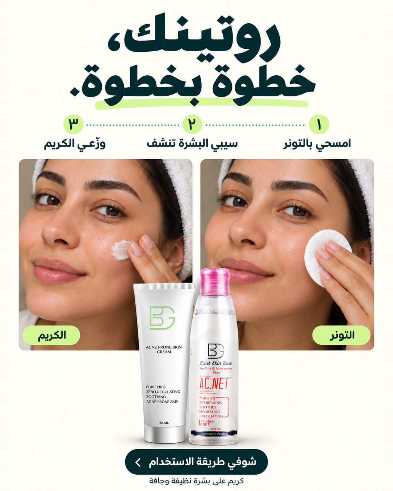
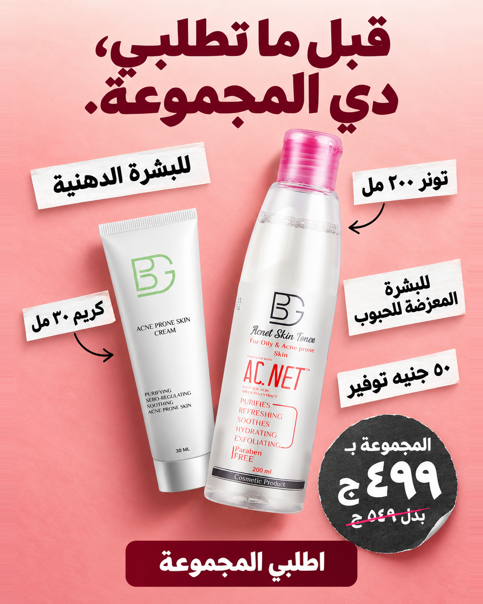

# النسخة الجديدة الكاملة — ١٠ تصميمات

كل الصور بمقاس **١٠٨٠ × ١٣٥٠**. المجموعة تشمل أول ٣ تصميمات معدّلة، والـ٧ تصميمات الجديدة.

[تحميل كل الصور والنصوص ZIP](https://github.com/moksehly11-netizen/test/raw/refs/heads/main/bg-meta-ads/revision-2/bg-revision-2-complete-10.zip) · [تحميل نصوص الإعلانات CSV](ad-copy-ar.csv?raw=true)

| رقم | المرجع البصري | زاوية الإعلان |
|---|---|---|
| 1 | [Goli — لقطة وجه ومنتج](01-goli-face.png) | النتيجة المرغوبة |
| 2 | [Poppi — عنوان وبطاقات وإيدين](02-poppi-three-cards.png) | تعليم واختيار الروتين |
| 3 | [AgeMate — سبورة ودوائر بخط اليد](03-agemate-whiteboard.png) | ربط فائدتين |
| 4 | [Rheal — منتج في الإيد وخلفية سماوية](04-rheal-hand-benefits.png) | التحكم في اللمعان |
| 5 | [ARMRA — رقم ضخم وخلفية سادة](05-armra-offer-number.png) | العرض والتوفير |
| 6 | [Spacegoods — عنوان تحريري وفقاعات فوائد](06-spacegoods-pores.png) | مظهر المسام |
| 7 | [ARMRA — مراجعة واحدة على صورة طبيعية](07-armra-real-review.png) | دليل اجتماعي حقيقي |
| 8 | [Botane — تقسيم تحريري ومنتج طويل](08-botane-ingredients.png) | شفافية المكونات |
| 9 | [Pore Favor — مسار خطوات وصورتان للاستخدام](09-porefavor-howto.png) | توضيح الاستخدام |
| 10 | [Nutrition Geeks — قصاصات حول المنتج](10-nutritiongeeks-kit-collage.png) | وضوح محتويات الطلب |

## 1. Goli — لقطة وجه ومنتج

**الزاوية:** النتيجة المرغوبة

**الهدف:** شرح فائدة

**الشريحة:** ٢٥–٣٥ سنة، تبحث عن عناية لتنظيم الدهون وتهدئة البشرة

**مستوى الوعي:** تبحث عن حل

**الهوك:** دهون أقل. / بشرة أهدى.

**النص الأساسي:** دهون أقل وبشرة أهدى: هدف واضح لروتين البشرة الدهنية. مجموعة BG بتجمع التونر والكريم للعناية بالبشرة الدهنية والمعرّضة للحبوب، والمساعدة على تنظيم الدهون وتهدئة البشرة. اكتشفي المجموعة بـ٤٩٩ بدل ٥٤٩ جنيه.

**العنوان:** عناية لبشرة أهدى

[تحميل الصورة](01-goli-face.png?raw=true)

## 2. Poppi — عنوان وبطاقات وإيدين

**الزاوية:** تعليم واختيار الروتين

**الهدف:** تعليم واختيار الروتين

**الشريحة:** ٢٠–٢٧ سنة، جديدة على اختيار روتين البشرة الدهنية

**مستوى الوعي:** واعٍ بالمشكلة

**الهوك:** ٣ حاجات تدوري عليهم / في روتين البشرة الدهنية

**النص الأساسي:** تنظيم الدهون، تهدئة البشرة، والمساعدة على تقليل الحبوب: ٣ احتياجات تدوري عليهم في روتين البشرة الدهنية. اتعرّفي على مجموعة BG، تونر ٢٠٠ مل وكريم ٣٠ مل، وشوفي تفاصيل المكونات والاستخدام.

**العنوان:** اختاري روتينك على أساس واضح

[تحميل الصورة](02-poppi-three-cards.png?raw=true)

## 3. AgeMate — سبورة ودوائر بخط اليد

**الزاوية:** ربط فائدتين

**الهدف:** ربط فائدتين

**الشريحة:** ٢٥–٤٠ سنة، تبحث عن مجموعة لتنظيم الدهون وتهدئة البشرة

**مستوى الوعي:** يقارن الحلول

**الهوك:** دهون أقل / بشرة أهدى

**النص الأساسي:** العناية بالبشرة الدهنية ليها أكتر من جانب. مجموعة BG بتجمع التونر والكريم للمساعدة على تنظيم الدهون وتهدئة البشرة المعرّضة للحبوب. المنتجين مع بعض بـ٤٩٩ بدل ٥٤٩ جنيه.

**العنوان:** تنظيم دهون + تهدئة البشرة

[تحميل الصورة](03-agemate-whiteboard.png?raw=true)

## 4. Rheal — منتج في الإيد وخلفية سماوية

**الزاوية:** التحكم في اللمعان

**الهدف:** شرح فائدة

**الشريحة:** ٢٥–٣٥ سنة، تبحث عن عناية لتنظيم الدهون

**مستوى الوعي:** تبحث عن حل

**الهوك:** لمعان أقل. / راحة أكتر.

**النص الأساسي:** العناية بالبشرة الدهنية مش بس تنظيف. كريم BG يساعد على تنظيم إفراز الدهون وتهدئة البشرة المعرّضة للحبوب. اكتشفيه مع التونر في مجموعة واحدة.

**العنوان:** عناية لتنظيم الدهون وتهدئة البشرة

[تحميل الصورة](04-rheal-hand-benefits.png?raw=true)

## 5. ARMRA — رقم ضخم وخلفية سادة

**الزاوية:** العرض والتوفير

**الهدف:** شراء العرض

**الشريحة:** ٢٣–٤٠ سنة، تعرف المنتج وتراجع السعر

**مستوى الوعي:** قريبة من الشراء

**الهوك:** وفّري / ٥٠ جنيه

**النص الأساسي:** مجموعة BG للبشرة الدهنية والمعرّضة للحبوب: تونر ٢٠٠ مل وكريم ٣٠ مل، مع بعض بـ٤٩٩ بدل ٥٤٩ جنيه. توفير ٥٠ جنيه على المجموعة.

**العنوان:** الكريم والتونر بـ٤٩٩ جنيه

[تحميل الصورة](05-armra-offer-number.png?raw=true)

## 6. Spacegoods — عنوان تحريري وفقاعات فوائد

**الزاوية:** مظهر المسام

**الهدف:** شرح فائدة التونر

**الشريحة:** ٢٤–٣٨ سنة، تبحث عن عناية بمظهر المسام

**مستوى الوعي:** واعٍ بالمشكلة

**الهوك:** مسام أقل وضوحًا. / عناية أوضح.

**النص الأساسي:** لو مظهر المسام من أولويات روتينك، اتعرّفي على تونر BG. يساعد على تقليل مظهر المسام وتنظيم الدهون الزائدة. اكتشفيه مع الكريم ضمن مجموعة BG.

**العنوان:** تونر BG للعناية بمظهر المسام

[تحميل الصورة](06-spacegoods-pores.png?raw=true)

## 7. ARMRA — مراجعة واحدة على صورة طبيعية

**الزاوية:** دليل اجتماعي حقيقي

**الهدف:** بناء الثقة

**الشريحة:** ٢٥–٤٠ سنة، مترددة وتقرأ تجارب الاستخدام

**مستوى الوعي:** واعٍ بالمنتج

**الهوك:** «التونر حلو جدا حاسه انه قلل ظهور الحبوب»

**النص الأساسي:** «التونر حلو جدا حاسه انه قلل ظهور الحبوب» — جزء من مراجعة علياء الحسيني المنشورة على موقع BG. تجربة عميلة وليست وعدًا بنفس النتيجة للجميع. اكتشفي تفاصيل مجموعة التونر والكريم بـ٤٩٩ بدل ٥٤٩ جنيه.

**العنوان:** رأي منشور عن تونر BG

[تحميل الصورة](07-armra-real-review.png?raw=true)

## 8. Botane — تقسيم تحريري ومنتج طويل

**الزاوية:** شفافية المكونات

**الهدف:** تعليم المكونات

**الشريحة:** ٢٥–٤٠ سنة، تقرأ قائمة المكونات قبل الاختيار

**مستوى الوعي:** يقارن الحلول

**الهوك:** عناية للبشرة الدهنية. / بمكونات تعرفيها.

**النص الأساسي:** بتراجعي المكونات قبل ما تختاري؟ كريم BG يحتوي على النياسيناميد، والتونر يحتوي على حمض الساليسيليك، بحسب قوائم المكونات على الموقع. اتعرّفي على تركيبة كل منتج وطريقة استخدامه ضمن روتين البشرة الدهنية.

**العنوان:** نياسيناميد في الكريم وساليسيليك في التونر

[تحميل الصورة](08-botane-ingredients.png?raw=true)

## 9. Pore Favor — مسار خطوات وصورتان للاستخدام

**الزاوية:** توضيح الاستخدام

**الهدف:** تعليم طريقة الاستخدام

**الشريحة:** ٢٠–٣٠ سنة، جديدة على استخدام التونر والكريم

**مستوى الوعي:** تبحث عن طريقة الاستخدام

**الهوك:** روتينك، / خطوة بخطوة.

**النص الأساسي:** امسحي الوجه بالتونر باستخدام قطنة، ومن غير شطف. ولما تكون البشرة نظيفة وجافة، وزّعي الكريم بتدليك خفيف. صفحة المنتج توصي بالكريم مرتين يوميًا؛ راجعي تعليمات العبوة قبل الاستخدام.

**العنوان:** استخدام التونر والكريم بوضوح

[تحميل الصورة](09-porefavor-howto.png?raw=true)

## 10. Nutrition Geeks — قصاصات حول المنتج

**الزاوية:** وضوح محتويات الطلب

**الهدف:** توضيح قيمة المجموعة ومحتوياتها

**الشريحة:** ٢٨–٤٠ سنة، تراجع الأحجام وما يصل في الطلب

**مستوى الوعي:** قريبة من الشراء

**الهوك:** قبل ما تطلبي، / دي المجموعة.

**النص الأساسي:** دي محتويات طلبك بوضوح: تونر BG بحجم ٢٠٠ مل وكريم BG بحجم ٣٠ مل. المجموعة بـ٤٩٩ بدل ٥٤٩ جنيه، لعناية البشرة الدهنية والمعرّضة للحبوب.

**العنوان:** تونر ٢٠٠ مل + كريم ٣٠ مل

[تحميل الصورة](10-nutritiongeeks-kit-collage.png?raw=true)

## المصادر وحدود الاستخدام

صور المنتجات الأصلية المقدمة من العميل وصفحة [مجموعة BG](https://bgcosmetics.org/products/full-oily-skin-kit-copy). السعر ٤٩٩ بدل ٥٤٩ جنيه مؤكد من العميل ومن الصفحة. الأحجام: تونر ٢٠٠ مل وكريم ٣٠ مل. صفحة المنتج تذكر تنظيم الدهون، تقليل الحبوب والاحمرار، والعناية بمظهر المسام ضمن فوائد المنتجات. النياسيناميد موجود في قائمة مكونات الكريم، وحمض الساليسيليك موجود في قائمة مكونات التونر. طريقة الاستخدام مأخوذة من الصفحة: التونر بقطنة بدون شطف، والكريم على بشرة نظيفة وجافة بتدليك خفيف، مرتين يوميًا.

اقتباس التصميم ٧ مقتطف حرفي من مراجعة علياء الحسيني المنشورة على الصفحة: «التونر حلو جدا حاسه انه قلل ظهور الحبوب». النص الكامل المنشور: «التونر حلو جدا حاسه انه قلل ظهور الحبوب و معمليش تحسس». لم توصف المراجعة بأنها عملية شراء موثقة، ولم تُخترع تقييمات أو أعداد عملاء.

الأشخاص والأيدي في الصور مولّدون لأغراض التصميم ولا يمثلون عميلات يشهدن بنتائج. صور التصميم ٩ توضيح للاستخدام وليست مقارنة قبل وبعد. الشرائح ومستويات الوعي فرضيات لاختبار الإعلانات. لا توجد نسب نجاح أو وعود زمنية أو ضمان نتائج، ولم يتم إطلاق حملة أو إنفاق ميزانية.
